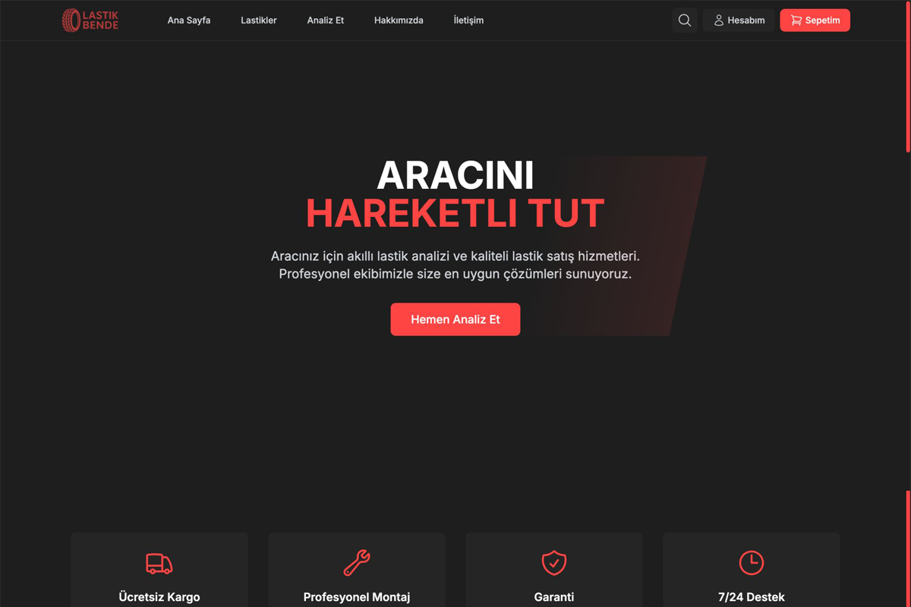
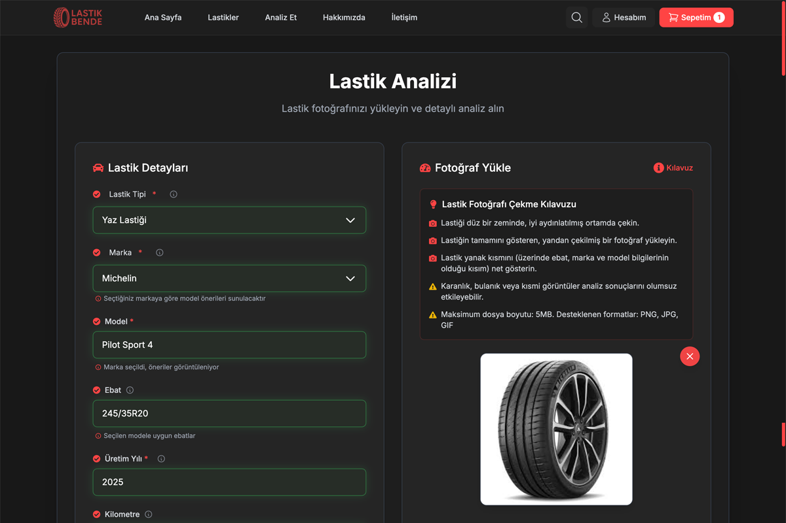
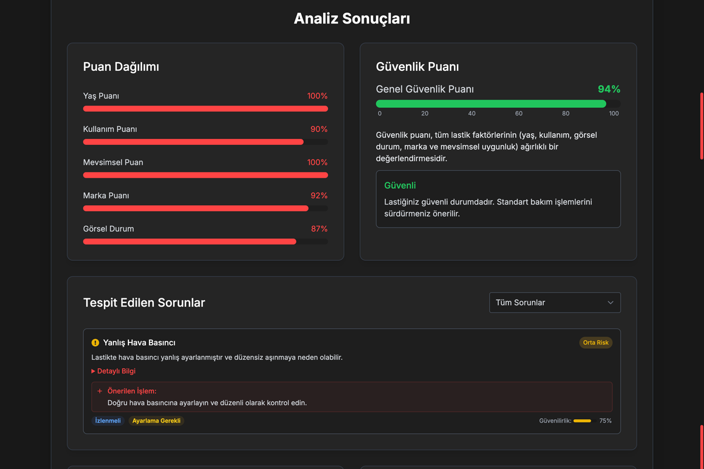
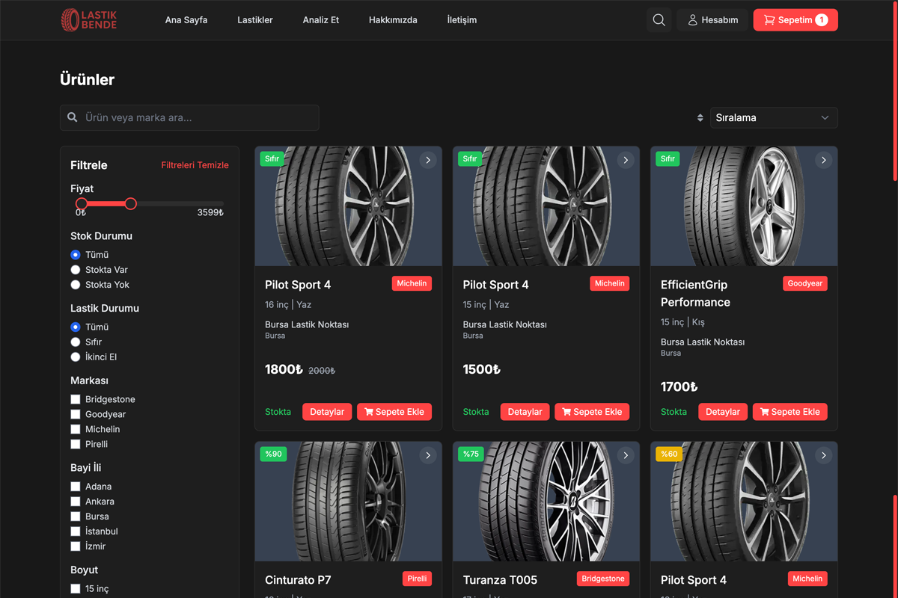
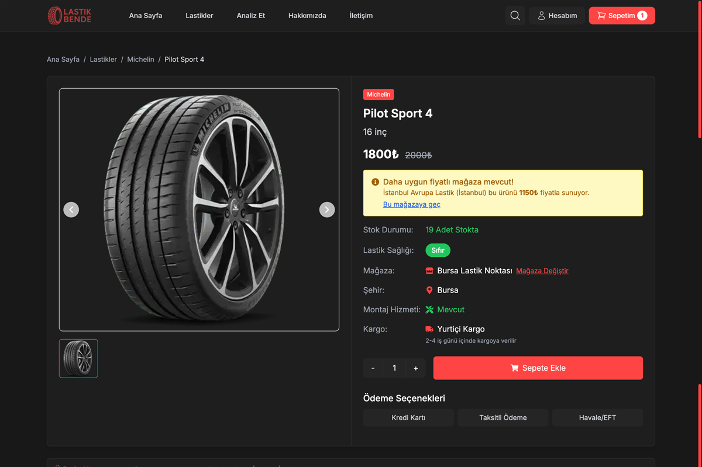
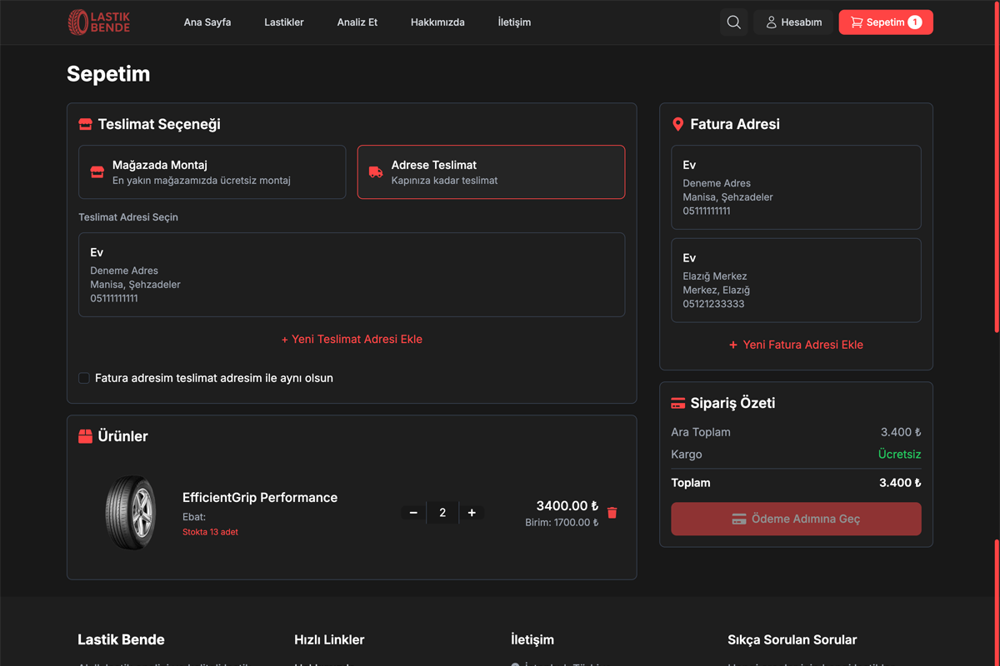
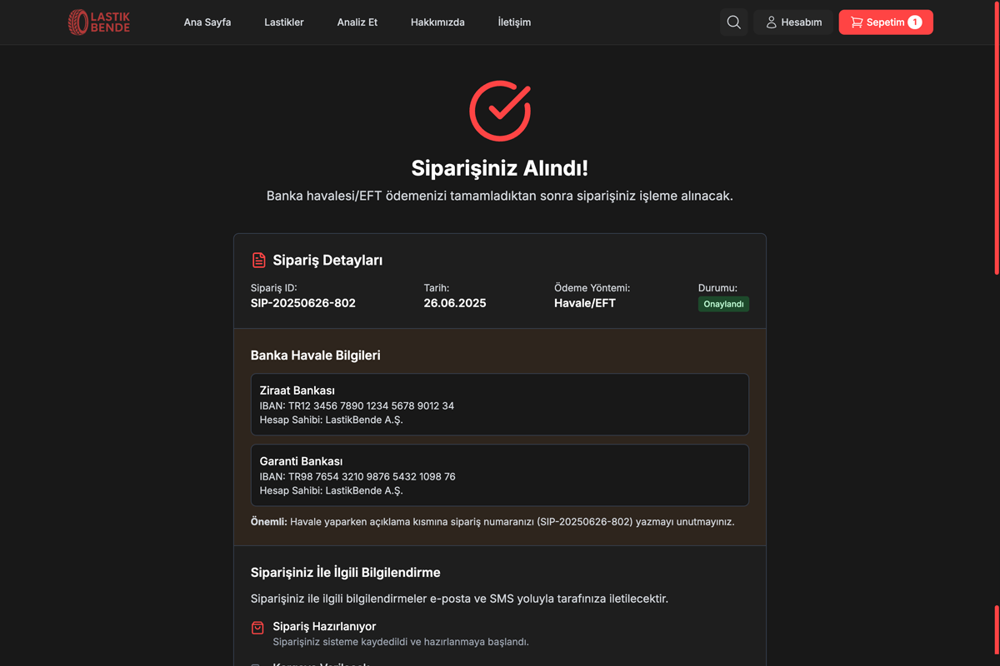
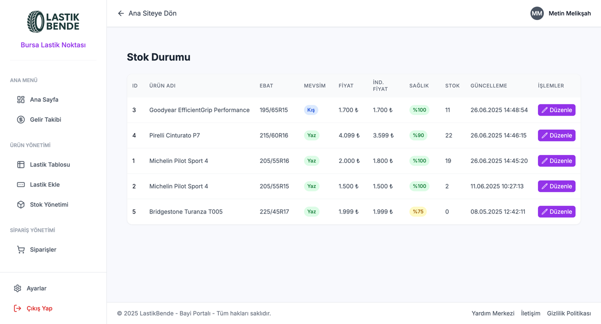
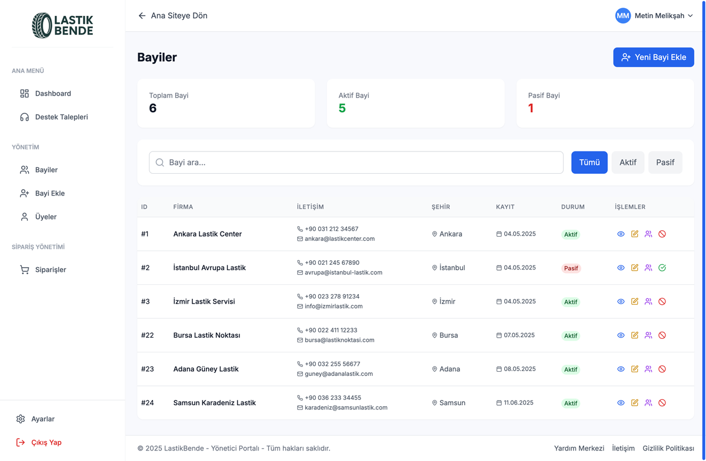

# LastikBende - Yapay Zeka Destekli Lastik Analiz Platformu

LastikBende, lastik analizi ve yönetimi için geliştirilmiş, Azure Computer Vision API ve yapay zeka teknolojilerini kullanan modern bir web uygulamasıdır. Platform, lastik durumunu analiz etme, raporlama ve uzman tavsiyeleri sunma özellikleriyle lastik güvenliğini ve performansını optimize etmeyi hedefler.

## 🚀 Özellikler

### 📸 Lastik Analizi
- Görüntü tabanlı lastik durumu değerlendirmesi
- Yapay zeka destekli sorun tespiti
- Güvenlik skoru ve kalan ömür hesaplaması
- Detaylı diş derinliği analizi
- Aşınma oranı tespiti

### 📊 Raporlama
- PDF, Excel ve Word formatlarında profesyonel raporlar
- Özelleştirilmiş tasarım ve görsel unsurlar
- Detaylı analiz çıktıları
- Bakım önerileri ve güvenlik tavsiyeleri

### 💬 Akıllı Lastik Uzmanı
- GPT-4o tabanlı lastik uzmanı asistanı
- Gerçek zamanlı mesajlaşma
- Analiz sonuçlarını otomatik değerlendirme
- Kişiselleştirilmiş bakım önerileri
- Markdown formatında zengin metin desteği

### 🛒 Gelişmiş E-Ticaret Sistemi
- Geniş Ürün Kataloğu: Binlerce lastik ve jant çeşidi
- Akıllı Filtreleme: Araç tipine göre uyumlu ürün önerisi
- Karşılaştırma Sistemi: Ürünleri yan yana karşılaştırma
- Güvenli Ödeme: Kredi kartı ve online ödeme seçenekleri
- Montaj Hizmeti: Yetkili servis ağı ile montaj koordinasyonu
- Kargo Takibi: Gerçek zamanlı teslimat takibi

### 👥 Çok Seviyeli Kullanıcı Yönetimi
### 🏠 Kullanıcı Paneli
- Kişisel profil yönetimi
- Analiz geçmişi ve raporlar
- Sipariş takibi
- Favoriler ve istek listesi
- Adres defteri yönetimi
### 🏪 Bayi Paneli
- Dashboard: Satış istatistikleri ve performans metrikleri
- Stok Yönetimi: Ürün ekleme, güncelleme ve stok takibi
- Sipariş Yönetimi: Gelen siparişleri görüntüleme ve işleme
- Gelir Raporları: Detaylı satış analizleri ve kar marjları
- Lastik Ekleme: Yeni ürün kataloguna ekleme
- Kritik Stok Uyarıları: Otomatik stok azalma bildirimleri
### ⚙️ Yönetici Paneli
- Sistem Dashboard: Genel platform istatistikleri
- Bayi Yönetimi: Bayi başvurularını onaylama ve yönetme
- Üye Yönetimi: Kullanıcı hesaplarını yönetme
- Sipariş Yönetimi: Tüm siparişleri görüntüleme ve yönetme
- Destek Sistemi: Kullanıcı destek taleplerini yönetme
- Sistem Ayarları: Platform geneli yapılandırma

## 🌟 Kullanıcı Deneyimi Akışları
### 🔍 Lastik Analiz Süreci
- Görüntü Yükleme: Lastik fotoğrafını sisteme yükleme
- AI Analizi: Azure Vision API ile otomatik analiz
- Sonuç Değerlendirmesi: GPT-4o ile detaylı değerlendirme
- Rapor Oluşturma: PDF/Excel/Word formatında rapor
- Uzman Tavsiyesi: AI chat ile ek danışmanlık
### 🛒 Alışveriş Süreci
- Ürün Keşfi: Kategoriler veya arama ile ürün bulma
- Karşılaştırma: Ürünleri yan yana karşılaştırma
- Sepete Ekleme: İstenilen ürünleri sepete ekleme
- Montaj Seçimi: Montaj bayi seçimi ve randevu
- Ödeme: Güvenli ödeme işlemi
- Takip: Sipariş ve kargo takibi
### 👨‍💼 Bayi İş Akışı
- Dashboard İnceleme: Günlük/aylık performans görüntüleme
- Sipariş Yönetimi: Gelen siparişleri işleme alma
- Stok Güncellemesi: Ürün stoklarını güncelleme
- Yeni Ürün Ekleme: Kataloga ürün ekleme
- Rapor İnceleme: Satış ve gelir raporlarını analiz etme

## 🛠️ Teknolojiler

### Frontend
- Next.js 14
- React 18
- TypeScript
- TailwindCSS
- Framer Motion
- React Query
- React Hook Form
- Zod

### Backend
- Next.js API Routes
- Azure Computer Vision API
- OpenAI GPT-4o
- PostgreSQL
- Redis Cache

### Araçlar ve Kütüphaneler
- Puppeteer (PDF oluşturma)
- ExcelJS (Excel raporlama)
- Docx (Word raporlama)
- Recharts (Grafikler)
- JSPDF (PDF işlemleri)

## 📁 Proje Yapısı

```
lastikbende/
├── app/                           # Next.js App Router
│   ├── analiz/                   # Lastik Analiz Modülü
│   │   ├── api/                  # Analiz API endpoints
│   │   ├── components/           # Analiz UI bileşenleri
│   │   ├── services/             # Azure Vision, OpenAI servisleri
│   │   ├── config/               # Analiz yapılandırmaları
│   │   ├── lib/                  # Yardımcı fonksiyonlar
│   │   ├── translations/         # Çeviri dosyaları
│   │   ├── types.ts              # TypeScript tip tanımları
│   │   └── page.tsx              # Ana analiz sayfası
│   │
│   ├── yonetici/                 # Yönetici Paneli
│   │   ├── bayiler/              # Bayi yönetimi
│   │   ├── siparisler/           # Sipariş yönetimi
│   │   ├── uyeler/               # Üye yönetimi
│   │   ├── destek/               # Destek talebi yönetimi
│   │   ├── ayarlar/              # Sistem ayarları
│   │   ├── profil/               # Yönetici profili
│   │   ├── components/           # Yönetici panel bileşenleri
│   │   ├── layout.tsx            # Yönetici panel layout'u
│   │   └── page.tsx              # Yönetici dashboard
│   │
│   ├── bayi/                     # Bayi Paneli
│   │   ├── siparisler/           # Sipariş yönetimi
│   │   ├── stok/                 # Stok durumu
│   │   ├── stok-ekle/            # Stok ekleme
│   │   ├── lastikler/            # Lastik kataloğu
│   │   ├── lastik-ekle/          # Yeni lastik ekleme
│   │   ├── raporlar/             # Satış raporları
│   │   ├── gelir/                # Gelir analizi
│   │   ├── ayarlar/              # Bayi ayarları
│   │   ├── components/           # Bayi panel bileşenleri
│   │   ├── layout.tsx            # Bayi panel layout'u
│   │   └── page.tsx              # Bayi dashboard
│   │
│   ├── kullanici/                # Kullanıcı Paneli
│   │   ├── giris/                # Giriş sayfası
│   │   ├── kayit/                # Kayıt sayfası
│   │   ├── components/           # Kullanıcı panel bileşenleri
│   │   ├── types.ts              # Kullanıcı tip tanımları
│   │   └── page.tsx              # Kullanıcı profili
│   │
│   ├── urunler/                  # Ürün Katalog Sayfası
│   │   └── page.tsx              # Filtreleme, arama, listeleme
│   │
│   ├── urun-detay/               # Ürün Detay Sayfası
│   │   └── [id]/                 # Dinamik ürün detay sayfası
│   │       └── page.tsx          # Ürün özellikleri, yorumlar, satın alma
│   │
│   ├── sepet/                    # Alışveriş Sepeti
│   ├── karsilastir/              # Ürün Karşılaştırma
│   ├── arama/                    # Gelişmiş Arama
│   ├── analizlerim/              # Kullanıcı Analiz Geçmişi
│   ├── iletisim/                 # İletişim Sayfası
│   ├── hakkimizda/               # Hakkımızda
│   ├── sss/                      # Sıkça Sorulan Sorular
│   ├── sozlesmeler/              # Yasal Metinler
│   │
│   ├── api/                      # API Routes
│   │   ├── auth/                 # Kimlik doğrulama
│   │   ├── user/                 # Kullanıcı işlemleri
│   │   └── agreement/            # Sözleşme işlemleri
│   │
│   ├── contexts/                 # React Context'ler
│   ├── components/               # Paylaşılan bileşenler
│   ├── lib/                      # Yardımcı kütüphaneler
│   ├── i18n/                     # Çok dil desteği
│   ├── globals.css               # Global stiller
│   ├── layout.tsx                # Ana layout
│   ├── page.tsx                  # Ana sayfa
│   ├── loading.tsx               # Yükleme sayfası
│   ├── not-found.tsx             # 404 sayfası
│   └── error.tsx                 # Hata sayfası
│
├── components/                    # Genel UI Bileşenleri
│   ├── ui/                       # Temel UI bileşenleri
│   ├── Navbar.tsx                # Navigasyon çubuğu
│   ├── Footer.tsx                # Alt bilgi
│   ├── Hero.tsx                  # Ana sayfa hero bölümü
│   ├── Services.tsx              # Hizmetler bölümü
│   ├── FeaturedProducts.tsx      # Öne çıkan ürünler
│   └── Categories.tsx            # Kategori listesi
│
├── lib/                          # Yardımcı Kütüphaneler
│   ├── utils.ts                  # Genel yardımcı fonksiyonlar
│   ├── cloudinary.ts             # Cloudinary entegrasyonu
│   └── supabase.ts               # Supabase client
│
├── docs/                         # Dokümantasyon
│   ├── diagrams/                 # Sistem diyagramları
│   │   ├── system-architecture.md
│   │   ├── data-flow.md
│   │   ├── deployment.md
│   │   └── testing-strategy.md
│   ├── README.md                 # Dokümantasyon ana sayfa
│   ├── ARCHITECTURE.md           # Mimari dokümantasyon
│   ├── FRONTEND.md               # Frontend rehberi
│   ├── BACKEND.md                # Backend rehberi
│   ├── DATABASE.md               # Veritabanı şeması
│   ├── API.md                    # API dokümantasyonu
│   ├── DEPLOYMENT.md             # Deployment kılavuzu
│   ├── TESTING.md                # Test stratejisi
│   ├── SECURITY.md               # Güvenlik politikaları
│   ├── DEVELOPMENT.md            # Geliştirme rehberi
│   ├── REQUIREMENTS.md           # Gereksinimler analizi
│   ├── ECOMMERCE.md              # E-ticaret modülü
│   ├── CONTRIBUTING.md           # Katkıda bulunma rehberi
│   └── CHANGELOG.md              # Değişiklik günlüğü
│
└── public/                       # Statik Dosyalar
    ├── images/                   # Görseller
    ├── icons/                    # İkonlar
    └── docs/                     # Dokümantasyon dosyaları
```

## 🚀 Başlangıç

### **Gereksinimler**
  - Node.js 18+
  - npm veya yarn
  - Azure Computer Vision API anahtarı
  - OpenAI API anahtarı

- **Kurulum**
  ```bash
  # Repoyu klonlayın
  git clone https://github.com/metinmeliksah/lastikbende.git
  cd lastikbende

  # Bağımlılıkları yükleyin
  npm install

  # Geliştirme sunucusunu başlatın
  npm run dev
  ```

- **Çevre Değişkenleri**
  ```env
  AZURE_VISION_KEY=your_azure_vision_api_key
  AZURE_VISION_ENDPOINT=your_azure_vision_endpoint
  OPENAI_API_KEY=your_openai_api_key
  DATABASE_URL=your_database_url
  REDIS_URL=your_redis_url
  ```

## 📚 Dokümantasyon

Detaylı dokümantasyon için aşağıdaki dosyaları inceleyin:

- [Mimari Dokümantasyon](docs/ARCHITECTURE.md)
- [Deployment Kılavuzu](docs/DEPLOYMENT.md)
- [Test Stratejisi](docs/TESTING.md)
- [Güvenlik Politikaları](docs/SECURITY.md)
- [Katkıda Bulunma Rehberi](docs/CONTRIBUTING.md)

## 🤝 Katkıda Bulunma

1. Bu repoyu fork edin
2. Feature branch oluşturun (`git checkout -b feature/amazing-feature`)
3. Değişikliklerinizi commit edin (`git commit -m 'feat: Add amazing feature'`)
4. Branch'inizi push edin (`git push origin feature/amazing-feature`)
5. Pull Request oluşturun

## 📝 Lisans

Bu proje MIT lisansı altında lisanslanmıştır. Detaylar için [LICENSE](LICENSE) dosyasını inceleyin.

## 📸 Ekran Alıntıları

Ana Sayfa


Lastik Analiz Ekranı


Lastik Analiz Sonucu


Ürünler Sayfası


Ürün Detay Sayfası


Sepet ve Sipariş Oluşturma Ekranı


Sipariş Takip Ekranı


Bayi Paneli


Yönetici Paneli


## 📞 İletişim

- Website: [lastikbende.com](https://lastikbende.com)
- Email: info@lastikbende.com
- Twitter: [@lastikbende](https://twitter.com/lastikbende)
- LinkedIn: [LastikBende](https://linkedin.com/company/lastikbende)
